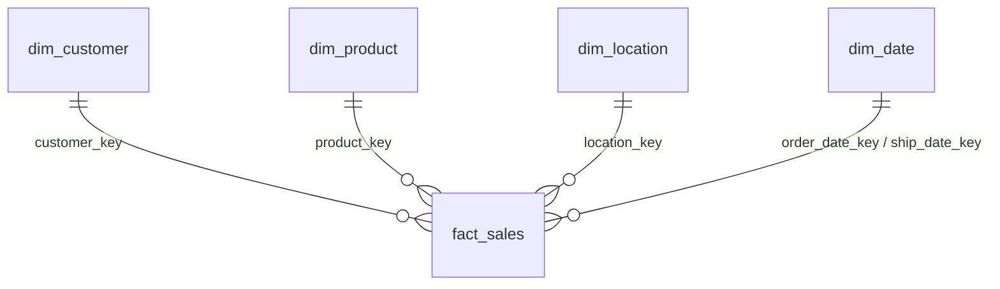

# Sales Data Warehouse (ETL with Python and PostgreSQL)

An ETL pipeline that cleans a raw retail sales CSV and loads it into a
PostgreSQL star schema, with SQL reports built on top.

## Dataset
Superstore sales data from Kaggle (https://www.kaggle.com/datasets/rohitsahoo/sales-forecasting?resource=download).
9,800 order lines, Jan 2015 to Dec 2018. Download it as `data/raw/train.csv`.

## Architecture


**Grain:** one row in `fact_sales` = one product line on one order.

| Table | Rows |
|---|---|
| fact_sales | 9,800 |
| dim_customer | 793 |
| dim_product | 1,861 |
| dim_location | 628 |
| dim_date | 1,826 |

## Pipeline
1. **Extract:** read the raw CSV (`latin-1` encoding) with pandas.
2. **Transform (`clean.py`):**
   - Standardized column names and trimmed whitespace
   - Parsed day/month/year dates with an explicit format
   - Filled 11 missing postal codes (all Burlington, VT)
   - Resolved 32 product IDs that had more than one name (kept the most common)
   - Validated the result: 0 nulls, 0 duplicates, no ship date before order date
3. **Load (`load.py`):** builds dimensions, generates surrogate keys,
   looks them up for the fact table, and loads everything in a single
   transaction. Safe to re-run. Assertions stop the load if any row
   fails a key lookup.

## Reports (`sql/reports.sql`)
Monthly revenue with month-over-month change (CTE + `LAG`), top products,
top sub-categories per category (`RANK`), regional share of yearly sales
(window over aggregate), top customers per segment (`ROW_NUMBER`),
and average shipping time by ship mode (date dimension joined twice).

## How to run
```bash
python3 -m venv venv && source venv/bin/activate
pip install -r requirements.txt
createdb sales_dw
psql -d sales_dw -f sql/schema.sql
python clean.py
python load.py
psql -d sales_dw -f sql/reports.sql
```

## Results
Total sales were $2,261,536.78 across 4,922 orders (9,800 order lines).

- Sales are seasonal: September, November and December are the strongest
  months every year, and January and February the weakest. November 2018
  was the peak at about $117,900.
- Yearly sales grew from about $480K in 2015 to about $722K in 2018,
  roughly 20% growth in the final year.
- The West led in 2018 with 34.4% of sales; the South was the smallest
  region in every year except 2015.
- Phones, Chairs and Storage were the top sub-categories in Technology,
  Furniture and Office Supplies. The top single product was the Canon
  imageCLASS 2200 copier at about $61.6K.

## Limitations
This dataset has no quantity or profit columns, so the fact table holds
sales amounts only.

## Tech
Python, pandas, SQLAlchemy, PostgreSQL

